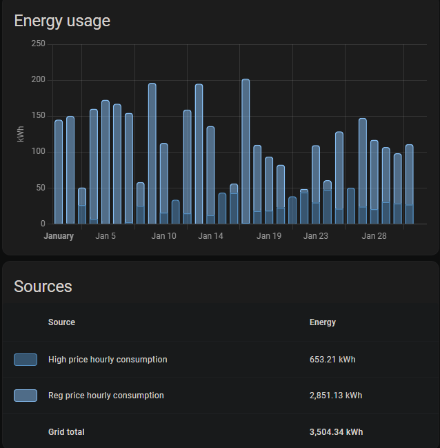

## Hourly Consumption in Energy Dashboard

{}
If you don't need consumption tracking or use another integration for this, you can disable consumption sync during initial setup or in the integration options. This prevents hourly consumption statistics from being imported and disables the history sync service.
{}

{}**Hourly consumption from Hydro-Québec is not live.** The hourly consumption will sync automatically when it is available from Hydro-Québec. On the website you can only see the hourly consumption from the previous day. There is always a delay of a few hours before HQ publishes the information.{}

When you enable hourly consumption sync, the integration imports consumption as Home Assistant **external statistics** (not sensors). The statistic IDs depend on your contract name (slugified):

- `hydroqc:<contract>_hourly_consumption` (total)
- `hydroqc:<contract>_reg_hourly_consumption` (regular/lower price)
- `hydroqc:<contract>_haut_hourly_consumption` (higher price)

### Rate D and D with CPC option (winter credits)

In the Energy Dashboard, use the total hourly consumption statistic in the "Grid Consumption" section.

### Flex-D and DT (dual energy)

For Flex-D and Bi-Energy rates, three statistics are imported: total, regular and higher price. Use the regular and higher price statistics to distinguish the two types of consumption in the dashboard.



## Historical Energy Consumption

### Initial Setup

Enabling hourly consumption sync during **hydroqc-ha** integration setup will automatically sync:

- Data from the **last 30 days** via regular sync (efficient and fast)
- For more than 30 days: automatic CSV import in the background during initial setup

### Manual History Import

The **hydroqc-ha** integration provides a Home Assistant service to manually import hourly consumption history up to **2000 days back**.

**Service**: `hydroqc.sync_consumption_history`

**Parameters**:

- `days_back`: Number of days to import (default: 731 days = ~2 years)
- `device_id`: The HydroQC device corresponding to your contract

**Usage in Actions**:

```yaml
action: hydroqc.sync_consumption_history
data:
  days_back: 365  # Import last year
target:
  device_id: <your_device_id>
```

**From the UI**:

1. Go to **Developer Tools** → **Services**
2. Select the service **HydroQC: Sync consumption history**
3. Select your HydroQC device
4. Specify the number of days (optional, default: 731)
5. Click **Call Service**

{}

- Import runs in the **background** and can take **30 minutes to 1 hour** depending on data volume
- Don't run the service multiple times consecutively - wait for the previous import to complete
- Check Home Assistant logs to monitor progress
- Import uses Hydro-Québec's CSV API (more efficient for large periods)

{}

### Managing Statistics

If you need to correct or delete hourly consumption statistics (for example, after an incorrect import), you can do so via Home Assistant's **Developer Tools**:

**Access statistics**:

1. Go to **Developer Tools** → **Statistics**
2. Search for your hourly consumption statistics (e.g., `hydroqc:home_hourly_consumption`)
3. Click on the statistic to see all recorded values

**Adjust or delete a statistic**:

1. Click the **Adjust sum** button to correct an incorrect value
2. Or select a date range and click **Delete** to erase data from a specific period
3. Changes will take effect immediately in the Energy Dashboard

{}

Deleting statistics is **permanent** and cannot be undone. Make sure you want to delete the data before confirming. If you accidentally delete history, you'll need to re-import the data using the `hydroqc.sync_consumption_history` service.

{}

**Common use cases**:

- Correct outliers caused by import errors
- Remove duplicates after accidental multiple imports
- Clean up statistics before a complete re-import
- Adjust data after a timezone change or DST transition
