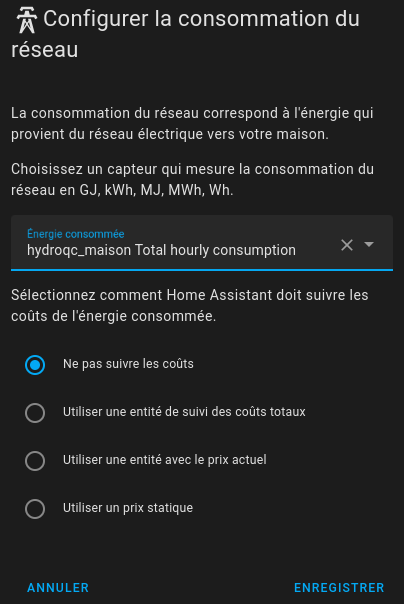
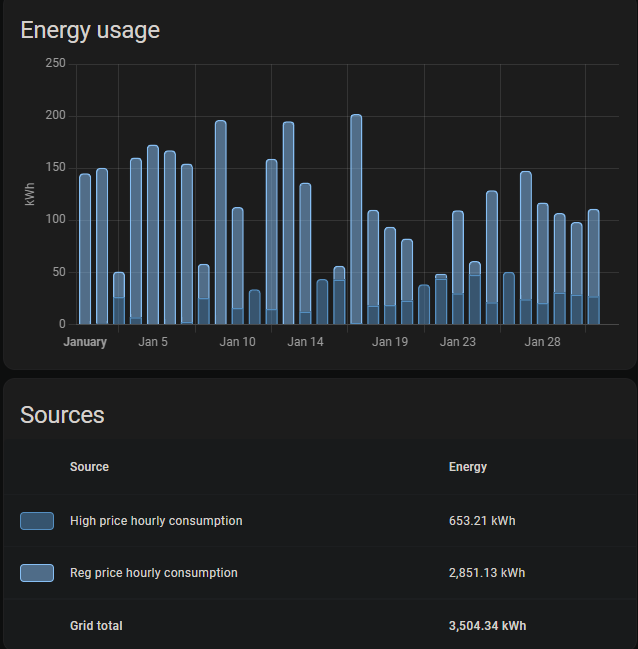

## Consommation horaire dans le tableau de bord énergétique

{}
Si vous n'avez pas besoin du suivi de consommation ou utilisez une autre intégration pour cela, vous pouvez désactiver la synchronisation de consommation lors de la configuration initiale ou dans les options de l'intégration. Cela empêchera l'importation des statistiques de consommation horaire et désactivera le service de synchronisation d'historique.
{}

{}**La consommation horaire d'Hydro-Québec n'est pas en direct.** La consommation horaire se synchronisera automatiquement lorsqu'elle sera disponible auprès d'Hydro-Québec. Dans le portail web d'Hydro-Québec, vous ne pouvez voir la consommation horaire que de la veille. Il y a toujours un retard de quelques heures avant la publication des données.{}

Lorsque vous activez la synchronisation de la consommation horaire, l'intégration importe la consommation sous forme de **statistiques externes** de Home Assistant (et non de capteurs). Les identifiants de statistiques dépendent du nom de votre contrat (slugifié):

- `hydroqc:<contrat>_hourly_consumption` (total)
- `hydroqc:<contrat>_reg_hourly_consumption` (prix régulier/inférieur)
- `hydroqc:<contrat>_haut_hourly_consumption` (prix supérieur)

### Tarif D et D avec option CPC (Crédits Hivernaux)

Dans le tableau de bord énergétique, utilisez la statistique de consommation horaire totale dans la section "Consommation du réseau".



### Tarifs Flex-D et DT (bi-énergie)

Pour les tarifs Flex-D et Bi-Énergie, trois statistiques sont importées: totale, prix régulier et prix supérieur. Utilisez les statistiques de prix régulier et de prix supérieur pour distinguer les deux types de consommation dans le tableau de bord.



## Historique de consommation d'énergie

### Configuration Initiale

L'activation de la synchronisation de consommation horaire durant la configuration de l'intégration **hydroqc-ha** synchronisera automatiquement:

- Les données des **30 derniers jours** via la synchronisation régulière (efficace et rapide)
- Pour plus de 30 jours: importation CSV automatique en arrière-plan lors de la configuration initiale

### Importation Manuelle de l'Historique

L'intégration **hydroqc-ha** fournit un service Home Assistant pour importer manuellement l'historique de consommation horaire jusqu'à **2000 jours en arrière**.

**Service**: `hydroqc.sync_consumption_history`

**Paramètres**:

- `days_back`: Nombre de jours à importer (défaut: 731 jours = ~2 ans)
- `device_id`: L'appareil HydroQC correspondant à votre contrat

**Utilisation dans les Actions**:

```yaml
action: hydroqc.sync_consumption_history
data:
  days_back: 365  # Importer la dernière année
target:
  device_id: <votre_device_id>
```

**Depuis l'interface**:

1. Allez dans **Outils pour développeurs** → **Services**
2. Sélectionnez le service **HydroQC: Sync consumption history**
3. Sélectionnez votre appareil HydroQC
4. Spécifiez le nombre de jours (optionnel, défaut: 731)
5. Cliquez sur **Appeler le service**

{}

- L'importation s'exécute en **arrière-plan** et peut prendre **30 minutes à 1 heure** selon la quantité de données
- N'exécutez pas le service plusieurs fois consécutivement - attendez que l'importation précédente se termine
- Vérifiez les journaux de Home Assistant pour suivre la progression
- L'importation utilise l'API CSV d'Hydro-Québec (plus efficace pour de grandes périodes)

{}

### Gestion des Statistiques

Si vous avez besoin de corriger ou supprimer des statistiques de consommation horaire (par exemple, après une importation incorrecte), vous pouvez le faire via les **Outils pour développeurs** de Home Assistant:

**Accéder aux statistiques**:

1. Allez dans **Outils pour développeurs** → **Statistiques**
2. Recherchez vos statistiques de consommation horaire (ex: `hydroqc:home_hourly_consumption`)
3. Cliquez sur la statistique pour voir toutes les valeurs enregistrées

**Ajuster ou supprimer une statistique**:

1. Cliquez sur le bouton **Ajuster la somme** pour corriger une valeur incorrecte
2. Ou sélectionnez une plage de dates et cliquez sur **Supprimer** pour effacer les données d'une période spécifique
3. Les modifications prendront effet immédiatement dans le tableau de bord énergétique

{}

La suppression de statistiques est **permanente** et ne peut pas être annulée. Assurez-vous de bien vouloir supprimer les données avant de confirmer. Si vous supprimez l'historique par erreur, vous devrez réimporter les données via le service `hydroqc.sync_consumption_history`.

{}
